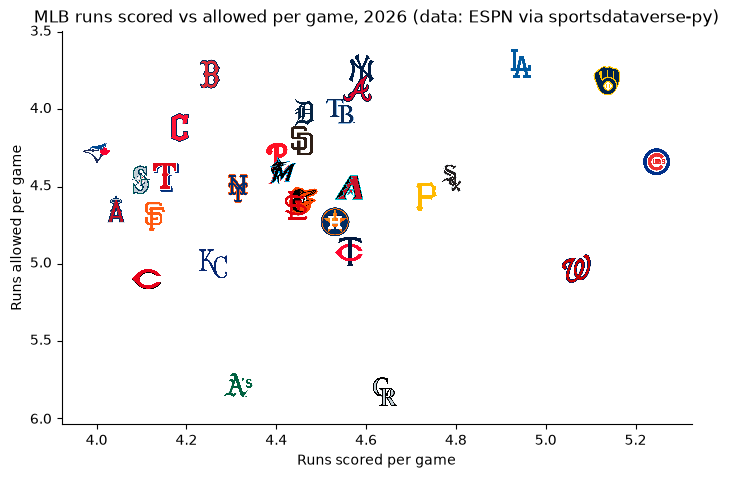

# HoloViews

[HoloViews](https://holoviews.org) builds charts from annotated data: you declare elements such as `Bars`,
`Scatter` and `Curve`, combine them with `*` (overlay) and `+` (layout), and a backend draws them. sdvplot
adds team logos, wordmarks and player headshots to those elements through a Bokeh plot hook, plus the team
colors and image URLs you need for the rest of the chart. The data is one season each from the NFL
(nflverse), the WNBA, NBA and men's college basketball (wehoop and hoopR) and MLB (ESPN), all through
sportsdataverse-py.

```python
import holoviews as hv
import polars as pl
import sportsdataverse.mbb as mbb
import sportsdataverse.mlb as mlb
import sportsdataverse.nba as nba
import sportsdataverse.nfl as nfl
import sportsdataverse.wnba as wnba
from bokeh.models import HoverTool

import sdvplot

hv.extension("bokeh", "matplotlib", logo=False)  # Bokeh is the current backend; matplotlib is for section 6
NFL_SEASON = 2025  # football names a season by the year it starts
SEASON = 2026  # the 2026 MLB and WNBA seasons, and the 2025-26 NBA and college basketball season
```

`hv.extension` loads BokehJS once for the notebook. The logos draw only on the Bokeh backend, and each
element needs a `frame_height` so the marks have a pixel size to scale from. The shared tables, each one
row per team or player: NFL offense EPA per play by week, WNBA scoring per game, the men's college
basketball ratings with each team's conference, and the NBA's leading scorers.

```python
nfl_weeks = nfl.load_nfl_team_stats([NFL_SEASON]).filter(pl.col("season_type") == "REG")
epa = pl.col("passing_epa").fill_null(0) + pl.col("rushing_epa").fill_null(0)
plays = pl.col("attempts") + pl.col("sacks_suffered") + pl.col("carries")
nfl_off = nfl_weeks.group_by("team").agg(off_epa=epa.sum() / plays.sum())

wnba_teams = (
    wnba.load_wnba_team_boxscore(seasons=[SEASON])
    .filter(pl.col("season_type") == 2)
    .group_by("team_abbreviation")
    .agg(games=pl.len(), scored=pl.col("team_score").mean(), allowed=pl.col("opponent_team_score").mean())
    .filter(pl.col("games") > 10)  # drops the All-Star Game's teams
    .with_columns(net=pl.col("scored") - pl.col("allowed"))
    .sort("team_abbreviation")
)

mbb_ratings = mbb.load_mbb_ratings(SEASON).join(
    sdvplot.teams("mbb").select("team_id", "name", "conference"), on="team_id"
)

nba_box = nba.load_nba_player_boxscore(seasons=[SEASON]).filter(
    pl.col("season_type") == 2, pl.col("did_not_play").not_()
)
scorers = (
    nba_box.group_by("athlete_id", "athlete_display_name")
    .agg(
        games=pl.len(),
        team=pl.col("team_abbreviation").last(),
        ppg=pl.col("points").mean(),
        ts=pl.col("points").sum()
        / (2 * (pl.col("field_goals_attempted").sum() + 0.44 * pl.col("free_throws_attempted").sum())),
    )
    .filter(pl.col("games") >= 50)
    .sort(["ppg", "athlete_id"], descending=[True, False])
    .head(12)
)
nfl_off.height, wnba_teams.height, mbb_ratings.height, scorers.height
```

<div class="sdv-output">

```text
(32, 15, 365, 12)
```

</div>

## 1. Bars in team colors, with wordmarks

`sdvplot.palette` returns a `{team: color}` dict keyed by your own values, which is the mapping
`hv.dim(...).categorize` wants for a categorical color. `add_wordmarks` then puts each team's wordmark on
top of its bar: pass the bar's category as x and a y a little above its value. The NFL's ten best offenses
by EPA per play:

```python
top10 = nfl_off.sort(["off_epa", "team"], descending=[True, False]).head(10)
colors = sdvplot.palette("nfl", teams=top10["team"])
peak = top10["off_epa"].max()
bars = hv.Bars(top10.to_pandas(), "team", "off_epa").opts(
    color=hv.dim("team").categorize(colors),
    frame_width=760,
    frame_height=380,
    ylim=(0, peak * 1.25),
    xlabel="",
    ylabel="Offense: EPA per play",
    title=f"The NFL's ten best offenses, {NFL_SEASON} regular season (data: nflverse via sportsdataverse-py)",
    tools=["hover"],
)
sdvplot.add_wordmarks(bars, top10["team"], top10["off_epa"] + peak * 0.1, top10["team"], league="nfl", height=0.05)
```

<div class="sdv-output">

<iframe class="sdv-frame" src="/outputs/cookbooks/holoviews/5_1.html" title="Interactive HoloViews figure" height="480" loading="lazy"></iframe>

</div>

## 2. An overlay of team-colored lines, with a logo at each line's end

`*` overlays elements on one set of axes, and `add_logos` works on the overlay as on a single element.
Color each `Curve` with `sdvplot.team_colors`, which returns the colors in the order of the teams you give
it, then put each team's logo just past its last point so the logos replace the legend, staggered where two
teams finish close. The AFC West's running total of offensive EPA, week by week:

```python
afc_west = ["DEN", "KC", "LAC", "LV"]
weekly = (
    nfl_weeks.filter(pl.col("team").is_in(afc_west))
    .sort("team", "week")
    .with_columns(total_epa=epa.cum_sum().over("team"))
    .select("team", "week", "total_epa")
)
last = weekly.group_by("team").agg(pl.all().last()).sort("total_epa")
nudge = pl.Series([0.7, 1.9] * 2)  # alternate the offsets, in finishing order
curves = hv.Overlay(
    [
        hv.Curve(weekly.filter(pl.col("team") == team).to_pandas(), "week", "total_epa").opts(color=color, line_width=3)
        for team, color in zip(afc_west, sdvplot.team_colors("nfl", afc_west), strict=True)
    ]
).opts(
    frame_width=700,
    frame_height=400,
    xlim=(0.5, weekly["week"].max() + 2.6),
    xlabel="Week",
    ylabel="Offensive EPA, season to date",
    title=f"AFC West offense, {NFL_SEASON} (data: nflverse via sportsdataverse-py)",
    show_legend=False,
)
sdvplot.add_logos(curves, last["week"] + nudge, last["total_epa"], last["team"], league="nfl", height=0.09)
```

<div class="sdv-output">

<iframe class="sdv-frame" src="/outputs/cookbooks/holoviews/7_1.html" title="Interactive HoloViews figure" height="480" loading="lazy"></iframe>

</div>

## 3. A layout of two views side by side

`+` places elements side by side. Add the marks to each element before you combine them; each keeps its
own hook. On the left, WNBA points scored against points allowed (allowed reversed, so good defense is up);
on the right, the same teams' net scoring margin as bars in team colors, with a logo at the end of each
bar. The bars are horizontal (`invert_axes=True`), so their marks take the value as x and the team as y.

```python
scatter = hv.Scatter(wnba_teams.to_pandas(), "scored", ["allowed", "team_abbreviation"]).opts(
    frame_width=360,
    frame_height=360,
    size=26,
    alpha=0,
    tools=["hover"],
    invert_yaxis=True,
    padding=0.12,
    xlabel="Points scored per game",
    ylabel="Points allowed per game",
    title="Scoring",
)
scatter = sdvplot.add_logos(
    scatter, wnba_teams["scored"], wnba_teams["allowed"], wnba_teams["team_abbreviation"], league="wnba",
    height=0.09,
)  # fmt: skip

ranked = wnba_teams.sort(["net", "team_abbreviation"], descending=[True, False])
reach = ranked["net"].abs().max() * 1.3
margin = hv.Bars(ranked.to_pandas(), "team_abbreviation", "net").opts(
    color=hv.dim("team_abbreviation").categorize(sdvplot.palette("wnba", teams=ranked["team_abbreviation"])),
    invert_axes=True,
    invert_yaxis=True,
    frame_width=360,
    frame_height=360,
    ylim=(-reach, reach),
    xlabel="",
    ylabel="Net points per game",
    title="Margin",
    yaxis=None,
)
ends = ranked["net"] + pl.Series([reach * 0.12 if v >= 0 else -reach * 0.12 for v in ranked["net"]])
margin = sdvplot.add_logos(
    margin, ends, ranked["team_abbreviation"], ranked["team_abbreviation"], league="wnba", height=0.06
)
(scatter + margin).opts(title=f"WNBA {SEASON} regular season (data: wehoop via sportsdataverse-py)")
```

<div class="sdv-output">

<iframe class="sdv-frame" src="/outputs/cookbooks/holoviews/9_1.html" title="Interactive HoloViews figure" height="480" loading="lazy"></iframe>

</div>

## 4. Small multiples, one panel per conference

Build one element per group and pass the list to `hv.Layout`; `.cols(2)` makes a grid, and the panels
share their axes, so a team's position compares across conferences. `sdvplot.teams("mbb")` supplies
each team's conference. The four largest conferences' adjusted offense and defense, defense reversed:

```python
conferences = ["Big Ten Conference", "Southeastern Conference", "Big 12 Conference", "Atlantic Coast Conference"]
panels = []
for conference in conferences:
    teams = mbb_ratings.filter(pl.col("conference") == conference)
    panel = hv.Scatter(teams.to_pandas(), "adj_o", ["adj_d", "name"]).opts(
        frame_width=330,
        frame_height=260,
        size=22,
        alpha=0,
        tools=["hover"],
        invert_yaxis=True,
        padding=0.1,
        xlabel="Adjusted offense",
        ylabel="Adjusted defense",
        title=conference.removesuffix(" Conference"),
    )
    panels.append(sdvplot.add_logos(panel, teams["adj_o"], teams["adj_d"], teams["team_id"], league="mbb", height=0.1))
hv.Layout(panels).cols(2)
```

<div class="sdv-output">

<iframe class="sdv-frame" src="/outputs/cookbooks/holoviews/11_1.html" title="Interactive HoloViews figure" height="480" loading="lazy"></iframe>

</div>

## 5. Headshots, with the player and team in the hover

`add_headshots` draws each player's ESPN headshot at his point. For the hover, `sdvplot.headshot_url` and
`sdvplot.logo_url` give the image URLs, so a Bokeh `HoverTool` with an HTML template can show the player's
face and team logo next to his numbers. The NBA's twelve leading scorers (at least 50 games), points per
game against true shooting:

```python
hover_data = scorers.with_columns(
    headshot=pl.Series([sdvplot.headshot_url(p, "nba") for p in scorers["athlete_id"]]),
    logo=pl.Series([sdvplot.logo_url(t, "nba") for t in scorers["team"]]),
)
hover = HoverTool(
    tooltips=(
        '<div> </div>'
        "<div><b>@athlete_display_name</b></div>"
        "<div>@ppg{0.0} points a game, @ts{0.0%} true shooting</div>"
    )
)
players = hv.Scatter(hover_data.to_pandas(), "ppg", ["ts", "athlete_display_name", "headshot", "logo"]).opts(
    frame_width=700,
    frame_height=440,
    size=40,
    alpha=0,
    tools=[hover],
    padding=0.12,
    xlabel="Points per game",
    ylabel="True shooting",
    title=f"NBA scoring leaders, {SEASON - 1}-{SEASON % 100} (data: hoopR via sportsdataverse-py)",
)
sdvplot.add_headshots(players, scorers["ppg"], scorers["ts"], scorers["athlete_id"], league="nba", height=0.11)
```

<div class="sdv-output">

<iframe class="sdv-frame" src="/outputs/cookbooks/holoviews/13_1.html" title="Interactive HoloViews figure" height="480" loading="lazy"></iframe>

</div>

## 6. A static PNG through the matplotlib backend

The logo hook is Bokeh-only, and a Bokeh PNG export needs a browser driver. For a static image, render the
same kind of element with HoloViews' matplotlib backend (`hv.render(..., backend="matplotlib")` returns a
matplotlib figure) and draw the logos on its axes with sdvplot's matplotlib adapter: `sdvplot.add_logos`
dispatches on the axes. MLB runs scored and allowed per game:

```python
mlb_standings = mlb.espn_mlb_standings(season=SEASON).with_columns(
    rs=pl.col("points_for") / pl.col("games_played"), ra=pl.col("points_against") / pl.col("games_played")
)
runs = hv.Scatter(mlb_standings.to_pandas(), "rs", "ra").opts(
    alpha=0,
    aspect=1.6,
    fig_inches=9,
    padding=0.1,
    invert_yaxis=True,
    xlabel="Runs scored per game",
    ylabel="Runs allowed per game",
    title=f"MLB runs scored vs allowed per game, {SEASON} (data: ESPN via sportsdataverse-py)",
    backend="matplotlib",
)
fig = hv.render(runs, backend="matplotlib")
sdvplot.add_logos(
    fig.axes[0], mlb_standings["rs"], mlb_standings["ra"], mlb_standings["team_abbreviation"], league="mlb",
    height=0.08,
)  # fmt: skip
fig
```

<div class="sdv-output">



</div>

## Run it yourself

<a href="pathname:///notebooks/cookbooks/holoviews.ipynb" download>Download the notebook</a> (outputs cleared) or [open it on GitHub](https://github.com/sportsdataverse/sdvplot/blob/main/examples/notebooks/cookbooks/holoviews.ipynb).
