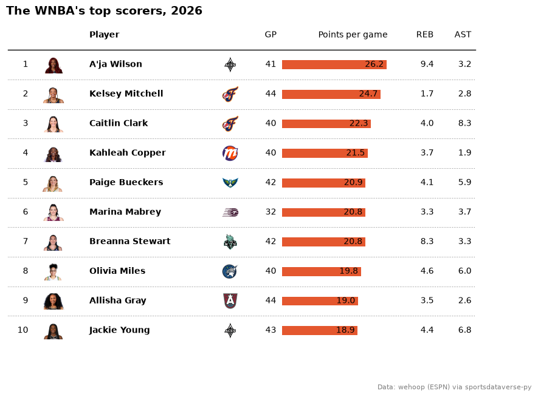
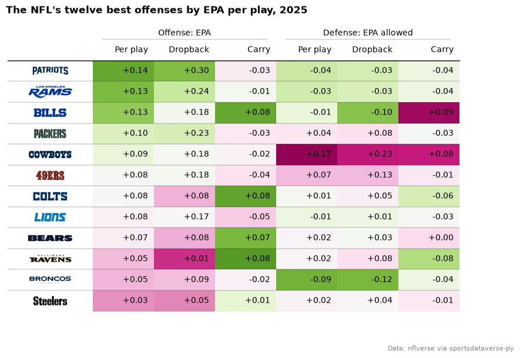
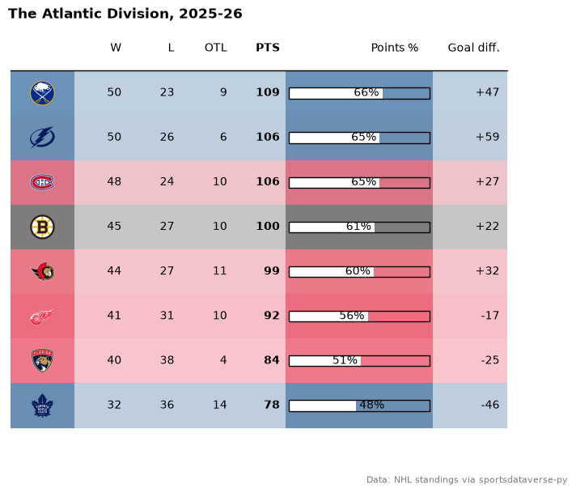
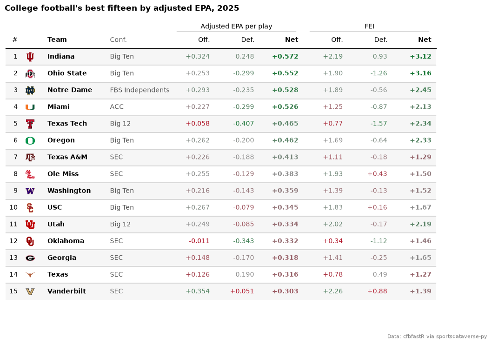
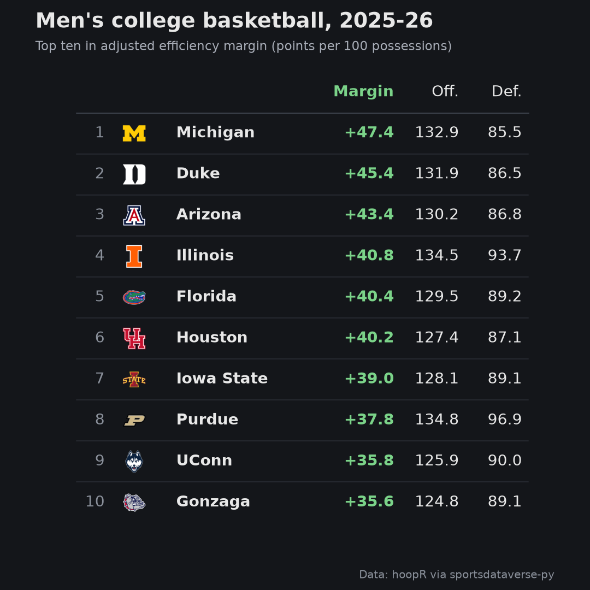

# plottable

[plottable](https://plottable.readthedocs.io/) draws a table as a matplotlib figure: every cell is an axes, so a
column can hold text, a bar or an image, and the finished table saves like any chart. `sdvplot.plottable`
adds two `ColumnDefinition` builders: `logo_column` draws each row's team as its logo or wordmark (any variant,
any season's mark) and `headshot_column` draws each row's player. `sdvplot.team_colors` supplies the colors for
team-tinted rows. The [Tables](tables.md) cookbook shows one MLB table with logos; these five recipes cover the
WNBA, NFL, NHL, college football and men's college basketball, through sportsdataverse-py, and end with a
square image sized for a social post. Saved images go to a temporary folder.

```python
import tempfile
from pathlib import Path

import matplotlib.pyplot as plt
import polars as pl
import sportsdataverse.cfb as cfb
import sportsdataverse.mbb as mbb
import sportsdataverse.nfl as nfl
import sportsdataverse.nhl as nhl
import sportsdataverse.wnba as wnba
from IPython.display import Image, display
from matplotlib import colormaps
from matplotlib.colors import LinearSegmentedColormap, to_rgba
from plottable import ColumnDefinition, Table
from plottable.cmap import normed_cmap
from plottable.plots import bar

import sdvplot
from sdvplot.plottable import headshot_column, logo_column

NFL_SEASON = 2025  # nflverse and cfbfastR name a season by the year it starts
SEASON = 2026  # the 2026 WNBA season and the 2025-26 NHL and men's college basketball seasons
OUT = Path(tempfile.mkdtemp())  # saved images go here, not into your working folder
```

## 1. Headshots and bars: the WNBA's leading scorers

`headshot_column` draws each row's player from an ESPN athlete id, and `logo_column` draws the team beside the
name. The points column uses plottable's `bar` plot function, so each scoring average is a bar with its value
written next to it. ESPN files the All-Star Game and the Commissioner's Cup final under the regular season too, so the box scores
are first cut to the schedule's standard games, and the cell checks that no one played more games than a team's
schedule holds. The 2026 regular season's top ten scorers with 20 or more games:

```python
# ESPN files the All-Star Game and the Commissioner's Cup final as regular-season games: keep the standard ones
schedule = wnba.load_wnba_schedule(seasons=[SEASON]).filter(
    (pl.col("season_type") == 2) & (pl.col("type_abbreviation") == "STD")
)
season_games = pl.concat([schedule["home_id"], schedule["away_id"]]).value_counts()["count"].max()
players = wnba.load_wnba_player_boxscore(seasons=[SEASON]).filter(
    pl.col("game_id").is_in(schedule["game_id"].implode()) & ~pl.col("did_not_play")
)
per_player = (
    players.sort("game_date")
    .group_by("athlete_id", "athlete_display_name", maintain_order=True)
    .agg(
        team=pl.col("team_abbreviation").last(),
        gp=pl.len(),
        ppg=pl.col("points").mean(),
        rpg=pl.col("rebounds").mean().round(1),
        apg=pl.col("assists").mean().round(1),
    )
)
assert per_player["gp"].max() <= season_games, "a player has more games than the schedule"
scorers = (
    per_player.filter(pl.col("gp") >= 20)
    .sort("ppg", descending=True)
    .head(10)
    .with_columns(rank=pl.int_range(1, 11))
    .select(
        "rank", photo="athlete_id", player="athlete_display_name", logo="team", gp="gp", ppg="ppg", rpg="rpg", apg="apg"
    )
    .to_pandas()
    .set_index("rank", drop=False)
)
fig, ax = plt.subplots(figsize=(10, 7))
Table(
    scorers,
    ax=ax,
    index_col="rank",
    column_definitions=[
        ColumnDefinition("rank", title="", width=0.3),
        headshot_column("photo", league="wnba", title="", width=0.6),
        ColumnDefinition("player", title="Player", width=1.8, textprops={"ha": "left", "weight": "bold"}),
        logo_column("logo", league="wnba", title="", width=0.5),
        ColumnDefinition("gp", title="GP", width=0.4),
        ColumnDefinition(
            "ppg",
            title="Points per game",
            width=1.6,
            plot_fn=bar,
            plot_kw={
                "xlim": (0, scorers["ppg"].max() * 1.1),
                "annotate": True,
                "color": "#e4572e",
                "height": 0.5,
                "formatter": "{:.1f}",
            },
        ),
        ColumnDefinition("rpg", title="REB", width=0.5),
        ColumnDefinition("apg", title="AST", width=0.5),
    ],
    row_divider_kw={"linewidth": 0.5, "linestyle": (0, (1, 3))},
)
ax.set_title(f"The WNBA's top scorers, {SEASON}", loc="left", fontweight="bold", fontsize=14)
fig.text(0.99, 0.01, "Data: wehoop (ESPN) via sportsdataverse-py", ha="right", fontsize=8, color="grey")
plt.show()
```

<div class="sdv-output">



</div>

## 2. Wordmarks and color scales: NFL EPA

`logo_column(mark_type="wordmark")` draws the team's wordmark instead of its logo. The six EPA columns use
plottable's `cmap` with `normed_cmap`, which centers each column's color scale on its mean: green is good, so the
defensive columns take the reversed map. `group=` puts an Offense and a Defense header over their columns. The
twelve best teams of 2025 by EPA per play:

```python
weeks = nfl.load_nfl_team_stats([NFL_SEASON]).filter(pl.col("season_type") == "REG")
dropbacks = pl.col("attempts") + pl.col("sacks_suffered")


def epa_rates(by):
    return weeks.group_by(team=by, maintain_order=True).agg(
        epa=(pl.col("passing_epa") + pl.col("rushing_epa")).sum() / (dropbacks + pl.col("carries")).sum(),
        pass_epa=pl.col("passing_epa").sum() / dropbacks.sum(),
        rush_epa=pl.col("rushing_epa").sum() / pl.col("carries").sum(),
    )


nfl_epa = (
    epa_rates(pl.col("team"))
    .join(epa_rates(pl.col("opponent_team")), on="team", suffix="_allowed")
    .sort("epa", descending=True)
    .head(12)
    .to_pandas()
    .set_index("team", drop=False)
)
good, bad = colormaps["PiYG"], colormaps["PiYG"].reversed()
labels = {"epa": "Per play", "pass_epa": "Dropback", "rush_epa": "Carry"}
fmt = "{:+.2f}"
fig, ax = plt.subplots(figsize=(10, 6.5))
Table(
    nfl_epa,
    ax=ax,
    index_col="team",
    column_definitions=[
        logo_column("team", league="nfl", mark_type="wordmark", title="", width=1.4),
        *[
            ColumnDefinition(
                c, title=labels[c], group="Offense: EPA", formatter=fmt, cmap=normed_cmap(nfl_epa[c], good)
            )
            for c in labels
        ],
        *[
            ColumnDefinition(
                f"{c}_allowed",
                title=labels[c],
                group="Defense: EPA allowed",
                formatter=fmt,
                cmap=normed_cmap(nfl_epa[f"{c}_allowed"], bad),
            )
            for c in labels
        ],
    ],
)
ax.set_title(f"The NFL's twelve best offenses by EPA per play, {NFL_SEASON}", loc="left", fontweight="bold")
fig.text(0.99, 0.01, "Data: nflverse via sportsdataverse-py", ha="right", fontsize=8, color="grey")
plt.show()
```

<div class="sdv-output">



</div>

## 3. Team-colored rows and track bars: an NHL division

`sdvplot.team_colors` returns each team's primary color, and after the table is drawn every row's cells take that
color at a quarter opacity (`table.rows[i].set_facecolor`). The points-percentage column is a white `bar` over
an outlined track (`plot_bg_bar`) on a 0 to 100% scale. The Atlantic Division's final 2025-26 standings:

```python
atlantic = (
    nhl.nhl_standings("2026-04-16")
    .filter(pl.col("division_name") == "Atlantic")
    .sort("points", descending=True)
    .select(
        logo="team_abbrev_default",
        w="wins",
        l="losses",
        otl="ot_losses",
        pts="points",
        pct="point_pctg",
        gd="goal_differential",
    )
    .to_pandas()
    .set_index("logo", drop=False)
)
fig, ax = plt.subplots(figsize=(8, 6.5))
table = Table(
    atlantic,
    ax=ax,
    index_col="logo",
    column_definitions=[
        logo_column("logo", league="nhl", title="", width=0.6),
        ColumnDefinition("w", title="W", width=0.5),
        ColumnDefinition("l", title="L", width=0.5),
        ColumnDefinition("otl", title="OTL", width=0.5),
        ColumnDefinition("pts", title="PTS", width=0.5, textprops={"weight": "bold"}),
        ColumnDefinition(
            "pct",
            title="Points %",
            width=1.4,
            plot_fn=bar,
            plot_kw={
                "xlim": (0, 1),
                "plot_bg_bar": True,
                "annotate": True,
                "color": "#ffffff",
                "height": 0.4,
                "formatter": "{:.0%}",
            },
        ),
        ColumnDefinition("gd", title="Goal diff.", width=0.7, formatter="{:+d}"),
    ],
    row_dividers=False,
)
for i, color in enumerate(sdvplot.team_colors("nhl", atlantic["logo"].tolist())):
    table.rows[i].set_facecolor(to_rgba(color, 0.25))
ax.set_title(f"The Atlantic Division, {SEASON - 1}-{SEASON % 100}", loc="left", fontweight="bold")
fig.text(0.99, 0.01, "Data: NHL standings via sportsdataverse-py", ha="right", fontsize=8, color="grey")
plt.show()
```

<div class="sdv-output">



</div>

## 4. Logos from ESPN ids: college football ratings

`logo_column` takes any id system sdvplot resolves; cfbfastR's ratings carry ESPN team ids, so the column reads
them with `id_system="espn"` and no name lookup. Two rating systems sit under their own group headers, each
column's text colored by its value (`text_cmap` with plottable's `normed_cmap`): green is good, red is
poor, and the defensive columns use the reversed scale because allowing less is better. The top fifteen of 2025 by net adjusted EPA per play:

```python
summaries = cfb.load_cfb_team_summaries(NFL_SEASON).select("team_id", "pos_team", "conference")
ratings = cfb.load_cfb_ratings(NFL_SEASON)
assert summaries.schema["team_id"] == ratings.schema["team_id"]
top15 = (
    ratings.join(summaries, on="team_id")
    .sort("net_rank")
    .head(15)
    .select(
        "net_rank",
        logo="team_id",
        team="pos_team",
        conf="conference",
        off="adj_off_epa",
        dfn="adj_def_epa",
        net="adj_net",
        fei_off="fei_off",
        fei_def="fei_def",
        fei_net="fei_net",
    )
    .to_pandas()
    .set_index("net_rank", drop=False)
)
epa_fmt, fei_fmt = "{:+.3f}", "{:+.2f}"
good = LinearSegmentedColormap.from_list("good", ["#b2182b", "#8c8c8c", "#1a7837"])  # dark enough to read as text


def scale(column, cmap=good):
    """Color a column's text by its value, centered on its median."""
    return normed_cmap(top15[column], cmap=cmap, num_stds=2)


fig, ax = plt.subplots(figsize=(12, 8))
Table(
    top15,
    ax=ax,
    index_col="net_rank",
    column_definitions=[
        ColumnDefinition("net_rank", title="#", width=0.3),
        logo_column("logo", league="cfb", id_system="espn", title="", width=0.5),
        ColumnDefinition("team", title="Team", width=1.4, textprops={"ha": "left", "weight": "bold"}),
        ColumnDefinition("conf", title="Conf.", width=1.5, textprops={"ha": "left", "color": "#555555"}),
        ColumnDefinition("off", title="Off.", group="Adjusted EPA per play", formatter=epa_fmt, text_cmap=scale("off")),
        ColumnDefinition(
            "dfn",
            title="Def.",
            group="Adjusted EPA per play",
            formatter=epa_fmt,
            text_cmap=scale("dfn", good.reversed()),
        ),
        ColumnDefinition(
            "net",
            title="Net",
            group="Adjusted EPA per play",
            formatter=epa_fmt,
            text_cmap=scale("net"),
            textprops={"weight": "bold"},
        ),
        ColumnDefinition("fei_off", title="Off.", group="FEI", formatter=fei_fmt, text_cmap=scale("fei_off")),
        ColumnDefinition(
            "fei_def", title="Def.", group="FEI", formatter=fei_fmt, text_cmap=scale("fei_def", good.reversed())
        ),
        ColumnDefinition(
            "fei_net",
            title="Net",
            group="FEI",
            formatter=fei_fmt,
            text_cmap=scale("fei_net"),
            textprops={"weight": "bold"},
        ),
    ],
    even_row_color="#f6f6f6",
)
ax.set_title(f"College football's best fifteen by adjusted EPA, {NFL_SEASON}", loc="left", fontweight="bold")
fig.text(0.99, 0.01, "Data: cfbfastR via sportsdataverse-py", ha="right", fontsize=8, color="grey")
plt.show()
```

<div class="sdv-output">



</div>

## 5. A square image for social: men's college basketball, dark

A social post wants a fixed pixel size, and a plottable table is a matplotlib figure, so the size is the figure's
inches times its dpi: 6 by 6 inches at 180 dpi is a 1080 by 1080 image. On a dark background `logo_column`'s
`variant="dark"` uses the logos drawn for one. The 2025-26 top ten in adjusted efficiency margin, saved to a file
and shown from it:

```python
names = mbb.load_mbb_team_boxscore(seasons=[SEASON]).select("team_id", "team_location").unique("team_id")
mbb_ratings = mbb.load_mbb_ratings(SEASON).with_columns(pl.col("team_id").cast(pl.Int32))  # ids ship as text here
assert names.schema["team_id"] == mbb_ratings.schema["team_id"]
top10 = (
    mbb_ratings.sort("rank")
    .head(10)
    .join(names, on="team_id", how="left")
    .select("rank", logo="team_id", team="team_location", em="adj_em", o="adj_o", d="adj_d")
    .to_pandas()
    .set_index("rank", drop=False)
)
BG, FG = "#14161a", "#e8e8e8"
fig, ax = plt.subplots(figsize=(6, 6), facecolor=BG)
ax.set_facecolor(BG)
Table(
    top10,
    ax=ax,
    index_col="rank",
    textprops={"color": FG, "fontsize": 11},
    column_definitions=[
        ColumnDefinition("rank", title="", width=0.3, textprops={"color": "#8a909a"}),
        logo_column("logo", league="mbb", id_system="espn", variant="dark", title="", width=0.5),
        ColumnDefinition("team", title="", width=1.5, textprops={"ha": "left", "weight": "bold"}),
        ColumnDefinition(
            "em", title="Margin", width=0.8, formatter="{:+.1f}", textprops={"color": "#7bd389", "weight": "bold"}
        ),
        ColumnDefinition("o", title="Off.", width=0.6, formatter="{:.1f}"),
        ColumnDefinition("d", title="Def.", width=0.6, formatter="{:.1f}"),
    ],
    col_label_divider_kw={"color": "#3a3f48"},
    row_divider_kw={"color": "#2c3038", "linewidth": 0.6},
)
fig.suptitle(
    f"Men's college basketball, {SEASON - 1}-{SEASON % 100}",
    x=0.06,
    ha="left",
    color=FG,
    fontweight="bold",
    fontsize=15,
)
fig.text(0.06, 0.915, "Top ten in adjusted efficiency margin (points per 100 possessions)", color="#a8adb7", fontsize=9)
fig.text(0.94, 0.02, "Data: hoopR via sportsdataverse-py", ha="right", fontsize=8, color="#8a909a")
path = OUT / "mbb_top10_square.png"
fig.savefig(path, dpi=180, facecolor=BG)
plt.close(fig)
print(plt.imread(path).shape[1::-1])
display(Image(filename=path, width=540))
```

<div class="sdv-output">

```text
(1080, 1080)
```



</div>

## Run it yourself

<a href="pathname:///notebooks/cookbooks/plottable.ipynb" download>Download the notebook</a> (outputs cleared) or [open it on GitHub](https://github.com/sportsdataverse/sdvplot/blob/main/examples/notebooks/cookbooks/plottable.ipynb).
