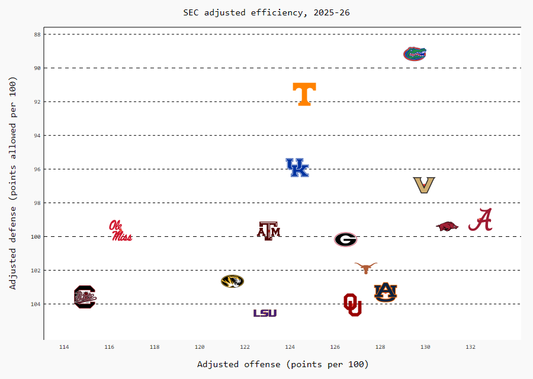

# pygal

[pygal](https://www.pygal.org/) draws charts as SVG, with hover tooltips built in. sdvplot adds two things to it:
`sdvplot.pygal.team_style()` turns a list of teams into a pygal `Style` whose series colors are the team colors, and
`add_logos` / `add_wordmarks` / `add_headshots` place images on any XY-family chart (`XY`, `DateLine`,
`DateTimeLine`, ...) at the exact spot pygal draws each point. pygal writes axis labels as text, so there are no axis
logos; `axis_logos` raises a `TypeError` that says so.

The data is one completed season each from the NFL (nflverse), MLB (ESPN), the NBA and men's college basketball
(hoopR), the WNBA (wehoop) and the NHL (fastRhockey), all through sportsdataverse-py.

```python
import polars as pl
import pygal
import sportsdataverse.mbb as mbb
import sportsdataverse.mlb as mlb
import sportsdataverse.nba as nba
import sportsdataverse.nfl as nfl
import sportsdataverse.nhl as nhl
import sportsdataverse.wnba as wnba
from IPython.display import HTML, Image, display

import sdvplot
import sdvplot.pygal

NFL_SEASON = 2025  # football names a season by the year it starts
SEASON = 2026  # the 2026 MLB and WNBA seasons, and the 2025-26 NBA, NHL and college basketball season


def show_svg(chart):
    """Show a pygal chart inline as SVG (the logos are drawn while pygal renders)."""
    display(HTML(chart.render(is_unicode=True, disable_xml_declaration=True)))


def pad(values, share=0.08):
    """An axis range with room at both ends, so the logos at the edges are not cut off."""
    lo, hi = min(values), max(values)
    return lo - (hi - lo) * share, hi + (hi - lo) * share
```

pygal's own notebook display is a PNG through cairosvg; `show_svg` keeps the chart as SVG so its tooltips work.
Every chart below renders with the logos, because sdvplot hooks into pygal's render step rather than editing one
finished SVG.

## 1. A scatter with team logos

A pygal scatter is an `XY` chart with `stroke=False`. Give each point a `label` so pygal's tooltip names the team,
then call `add_logos` with the same x and y. NFL offense against defense, EPA per play:

```python
weeks = nfl.load_nfl_team_stats([NFL_SEASON]).filter(pl.col("season_type") == "REG")
plays = pl.col("attempts") + pl.col("sacks_suffered") + pl.col("carries")
epa = pl.col("passing_epa") + pl.col("rushing_epa")
nfl_epa = (
    weeks.group_by("team", maintain_order=True)
    .agg(off_epa=epa.sum() / plays.sum())
    .join(
        weeks.group_by(team=pl.col("opponent_team"), maintain_order=True).agg(def_epa=epa.sum() / plays.sum()),
        on="team",
    )
    .sort("team")
)

chart = pygal.XY(
    stroke=False, width=800, height=560, dots_size=3, show_legend=False,
    xrange=pad(nfl_epa["off_epa"]), range=pad(nfl_epa["def_epa"]),
    title=f"NFL EPA per play, {NFL_SEASON} regular season (lower defense EPA is better)",
    x_title="Offense EPA per play", y_title="Defense EPA per play allowed",
)  # fmt: skip
chart.add("teams", [{"value": (o, d), "label": t} for t, o, d in nfl_epa.iter_rows()])
sdvplot.add_logos(chart, nfl_epa["off_epa"], nfl_epa["def_epa"], nfl_epa["team"], league="nfl", height=0.08)
show_svg(chart)
```

<div class="sdv-output">

<iframe class="sdv-frame" src="/outputs/cookbooks/pygal/3_0.html" title="HTML output" height="480" loading="lazy"></iframe>

</div>

## 2. Wordmarks instead of logos

`add_wordmarks` takes the same arguments as `add_logos`. A wordmark is wider than it is tall, so a smaller `height`
keeps neighbours apart, and a wordmark with a lot of empty space around its letters draws small. MLB runs scored and allowed per game:

```python
mlb_runs = (
    mlb.espn_mlb_standings(season=SEASON)
    .with_columns(
        rs=pl.col("points_for") / pl.col("games_played"), ra=pl.col("points_against") / pl.col("games_played")
    )
    .sort("team_abbreviation")
)

chart = pygal.XY(
    stroke=False, width=800, height=560, dots_size=2, show_legend=False,
    xrange=pad(mlb_runs["rs"]), range=pad(mlb_runs["ra"]),
    title=f"MLB runs scored and allowed per game, {SEASON}", x_title="Runs scored per game",
    y_title="Runs allowed per game",
)  # fmt: skip
chart.add(
    "teams", [{"value": (s, a), "label": t} for t, s, a in mlb_runs.select("team_abbreviation", "rs", "ra").iter_rows()]
)
sdvplot.add_wordmarks(chart, mlb_runs["rs"], mlb_runs["ra"], mlb_runs["team_abbreviation"], league="mlb", height=0.07)
show_svg(chart)
```

<div class="sdv-output">

<iframe class="sdv-frame" src="/outputs/cookbooks/pygal/5_0.html" title="HTML output" height="480" loading="lazy"></iframe>

</div>

## 3. Team colors on a bar chart

`team_style()` works on every pygal chart, not only XY: it returns a `Style` whose colors follow the order you add
the series. Add one series per team and each bar takes its team's primary color; a `label` on each value and
`print_labels=True` write the team on its bar. The ten NBA teams that took the most threes per game:

```python
nba_threes = (
    nba.load_nba_team_boxscore(seasons=[SEASON])
    .filter(pl.col("season_type") == 2)
    .group_by("team_id", "team_abbreviation", maintain_order=True)
    .agg(games=pl.len(), fg3a=pl.col("three_point_field_goals_attempted").mean())
    .filter(pl.col("games") > 10)
    .with_columns(pl.col("team_id").cast(pl.Int64).cast(pl.Utf8))
    .sort("fg3a", descending=True)
    .head(10)
)

style = sdvplot.pygal.team_style(nba_threes["team_id"], league="nba", font_family="sans-serif")
chart = pygal.Bar(
    style=style, width=800, height=480, show_legend=False, print_labels=True,
    title=f"NBA three-point attempts per game, {SEASON - 1}-{SEASON % 100} (top 10)", y_title="3PA per game",
)  # fmt: skip
for team, fg3a in nba_threes.select("team_abbreviation", "fg3a").iter_rows():
    chart.add(team, [{"value": round(fg3a, 1), "label": team}])
show_svg(chart)
```

<div class="sdv-output">

<iframe class="sdv-frame" src="/outputs/cookbooks/pygal/7_0.html" title="HTML output" height="480" loading="lazy"></iframe>

</div>

## 4. Player headshots

`add_headshots` places ESPN headshots by athlete id. WNBA scoring leaders, points per game against minutes per
game (players with at least 20 games):

```python
# ESPN files the All-Star Game and the Commissioner's Cup final as regular-season games: keep the standard ones
schedule = wnba.load_wnba_schedule(seasons=[SEASON]).filter(
    (pl.col("season_type") == 2) & (pl.col("type_abbreviation") == "STD")
)
season_games = pl.concat([schedule["home_id"], schedule["away_id"]]).value_counts()["count"].max()
per_player = (
    wnba.load_wnba_player_boxscore(seasons=[SEASON])
    .filter(
        pl.col("game_id").is_in(schedule["game_id"].implode())
        & pl.col("did_not_play").not_()
        & pl.col("minutes").is_not_null()
    )
    .group_by("athlete_id", "athlete_display_name", maintain_order=True)
    .agg(games=pl.len(), mpg=pl.col("minutes").mean(), ppg=pl.col("points").mean())
)
assert per_player["games"].max() <= season_games, "a player has more games than the schedule"
wnba_players = (
    per_player.filter(pl.col("games") >= 20)
    .sort("ppg", descending=True)
    .head(12)
    .with_columns(pl.col("athlete_id").cast(pl.Int64).cast(pl.Utf8))
)

chart = pygal.XY(
    stroke=False, width=800, height=560, dots_size=2, show_legend=False,
    xrange=pad(wnba_players["mpg"]), range=pad(wnba_players["ppg"], 0.12),
    title=f"WNBA scoring leaders, {SEASON}", x_title="Minutes per game", y_title="Points per game",
)  # fmt: skip
chart.add(
    "players",
    [
        {"value": (m, p), "label": n}
        for n, m, p in wnba_players.select("athlete_display_name", "mpg", "ppg").iter_rows()
    ],
)
sdvplot.add_headshots(
    chart, wnba_players["mpg"], wnba_players["ppg"], wnba_players["athlete_id"], league="wnba", height=0.1
)
show_svg(chart)
```

<div class="sdv-output">

<iframe class="sdv-frame" src="/outputs/cookbooks/pygal/9_0.html" title="HTML output" height="480" loading="lazy"></iframe>

</div>

## 5. A date line: team colors and a logo at the end of each line

`DateLine` is in the XY family, so the logos take dates for x. Here `team_style()` colors the lines and
`add_logos` marks where each team finished. Cumulative wins in the standard games
of the schedule above, for four WNBA teams spread evenly from the top of the standings to the bottom:

```python
wnba_games = (
    wnba.load_wnba_team_boxscore(seasons=[SEASON])
    .filter(pl.col("game_id").is_in(schedule["game_id"].implode()))
    .sort("game_date")
    .with_columns(wins=pl.col("team_winner").cast(pl.Int64).cum_sum().over("team_abbreviation"))
)
standings = (
    wnba_games.group_by("team_abbreviation")
    .agg(pl.col("wins").max())
    .sort(["wins", "team_abbreviation"], descending=[True, False])
)["team_abbreviation"]
n = standings.len()
leaders = standings.gather([round(i * (n - 1) / 3) for i in range(4)]).to_list()  # first, last and two between
ends_max = wnba_games["wins"].max()

chart = pygal.DateLine(
    style=sdvplot.pygal.team_style(leaders, league="wnba"), width=800, height=480, dots_size=2,
    x_label_rotation=25, legend_at_bottom=True, range=(0, ends_max * 1.12), y_title="Wins",
    title=f"WNBA cumulative wins, {SEASON}",
)  # fmt: skip
ends = []
for team in leaders:
    rows = wnba_games.filter(pl.col("team_abbreviation") == team).select("game_date", "wins")
    chart.add(team, list(rows.iter_rows()))
    ends.append(rows.row(-1))
sdvplot.add_logos(chart, [d for d, _ in ends], [w for _, w in ends], leaders, league="wnba", height=0.09)
show_svg(chart)
```

<div class="sdv-output">

<iframe class="sdv-frame" src="/outputs/cookbooks/pygal/11_0.html" title="HTML output" height="480" loading="lazy"></iframe>

</div>

## 6. A dark chart with dark-background logos

`team_style()` passes any other `Style` option through, so one call sets the team colors and a dark background.
`variant="dark"` picks each team's logo drawn for dark backgrounds. NHL goals for and against per game, with each
team its own series so its dot takes its secondary color (the logos name the teams, so the legend is off):

```python
nhl_teams = (
    nhl.load_nhl_team_box(seasons=[SEASON])
    .filter(pl.col("game_id") // 10_000 % 100 == 2)
    .group_by("team_abbrev", maintain_order=True)
    .agg(gf=pl.col("goals").mean(), ga=pl.col("goals_against").mean())
    .sort("team_abbrev")
)

dark = sdvplot.pygal.team_style(
    nhl_teams["team_abbrev"], league="nhl", which="secondary", background="#15171c", plot_background="#15171c",
    foreground="#d6d8de", foreground_strong="#ffffff", foreground_subtle="#3a3e48",
)  # fmt: skip
chart = pygal.XY(
    style=dark, stroke=False, width=800, height=560, dots_size=4, show_legend=False,
    xrange=pad(nhl_teams["gf"]), range=pad(nhl_teams["ga"]),
    title=f"NHL goals for and against per game, {SEASON - 1}-{SEASON % 100}", x_title="Goals for per game",
    y_title="Goals against per game", inverse_y_axis=True,
)  # fmt: skip
for team, gf, ga in nhl_teams.iter_rows():
    chart.add(team, [(gf, ga)])
sdvplot.add_logos(
    chart, nhl_teams["gf"], nhl_teams["ga"], nhl_teams["team_abbrev"], league="nhl", variant="dark", height=0.07
)
show_svg(chart)
```

<div class="sdv-output">

<iframe class="sdv-frame" src="/outputs/cookbooks/pygal/13_0.html" title="HTML output" height="480" loading="lazy"></iframe>

</div>

## 7. Export a PNG

pygal's `render_to_png()` rasterizes the SVG with cairosvg. cairosvg does not fetch linked images, so pass
`embed=True`: sdvplot puts each logo in the SVG as a data URI and the PNG needs no network. The SEC's adjusted
offensive and defensive efficiency:

```python
sec = (
    mbb.load_mbb_ratings(SEASON)
    .join(
        sdvplot.teams("mbb").filter(pl.col("conference") == "Southeastern Conference").select("team_id", "name"),
        on="team_id",
    )
    .sort("team_id")
)

chart = pygal.XY(
    stroke=False, width=900, height=640, dots_size=2, show_legend=False,
    xrange=pad(sec["adj_o"]), range=pad(sec["adj_d"]),
    title=f"SEC adjusted efficiency, {SEASON - 1}-{SEASON % 100}", x_title="Adjusted offense (points per 100)",
    y_title="Adjusted defense (points allowed per 100)", inverse_y_axis=True,
)  # fmt: skip
chart.add("teams", [{"value": (o, d), "label": n} for n, o, d in sec.select("name", "adj_o", "adj_d").iter_rows()])
sdvplot.add_logos(
    chart, sec["adj_o"], sec["adj_d"], sec["team_id"], league="mbb", season=SEASON, height=0.08, embed=True
)
display(Image(data=chart.render_to_png(dpi=144), width=760))
```

<div class="sdv-output">



</div>

## Run it yourself

<a href="pathname:///notebooks/cookbooks/pygal.ipynb" download>Download the notebook</a> (outputs cleared) or [open it on GitHub](https://github.com/sportsdataverse/sdvplot/blob/main/examples/notebooks/cookbooks/pygal.ipynb).
