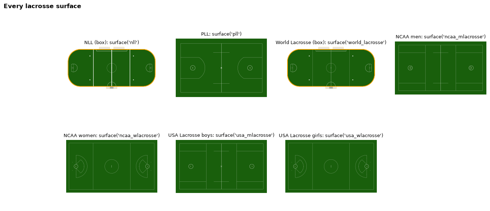
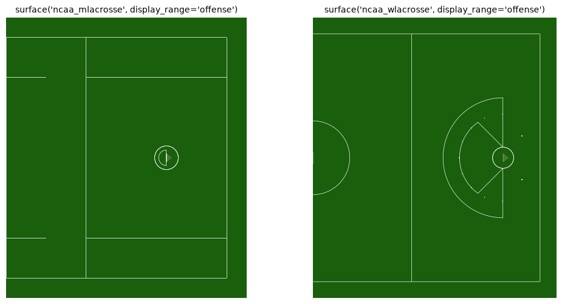
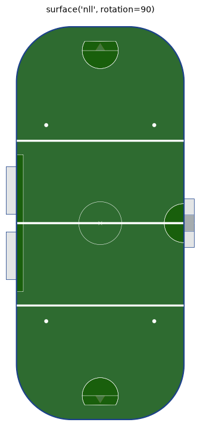
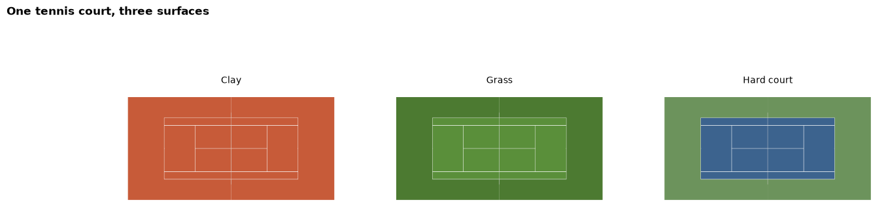
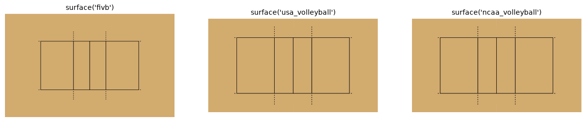
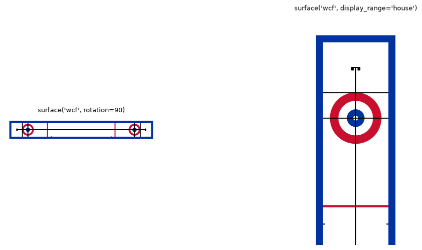

# Lacrosse, tennis, volleyball and curling

Seven examples from the four sports whose surfaces sdvplot draws but whose teams it does not hold yet: every lacrosse
field and box, the men's and women's goal areas, a box rink turned and recolored, a tennis court on three surfaces, the volleyball
courts and a curling sheet. `surface()` draws them all through sportypy, from sportyR's dimensions. None of these keys is an SDV
team league, so there is no team to color by; sportypy's `color_updates`, `display_range` and `rotation` work as on
any other surface. There is no data on this page: the SportsDataverse publishes none for these sports yet.

```python
import matplotlib.pyplot as plt

import sdvplot
```

## 1. Every lacrosse field and box

Seven lacrosse surfaces: the NLL and World Lacrosse play box lacrosse in a rink with boards; the PLL, NCAA and USA
Lacrosse fields are outdoor field lacrosse, with the men's and women's rule books marking the goal areas differently.

```python
lacrosse = [
    ("nll", "NLL (box)"),
    ("pll", "PLL"),
    ("world_lacrosse", "World Lacrosse (box)"),
    ("ncaa_mlacrosse", "NCAA men"),
    ("ncaa_wlacrosse", "NCAA women"),
    ("usa_mlacrosse", "USA Lacrosse boys"),
    ("usa_wlacrosse", "USA Lacrosse girls"),
]
fig, axes = plt.subplots(2, 4, figsize=(15, 6.5))
for ax, (league, label) in zip(axes.flat[:-1], lacrosse, strict=True):
    sdvplot.surface(league, ax=ax)
    ax.set_title(f"{label}: surface({league!r})", fontsize=9)
axes.flat[-1].set_axis_off()
fig.suptitle("Every lacrosse surface", x=0.01, ha="left", fontweight="bold")
plt.show()
```

<div class="sdv-output">



</div>

## 2. The men's and women's goal areas

`display_range="offense"` draws the attacking half. The NCAA men's field has a crease and a box around the goal;
the women's has the 8-meter arc and the 12-meter fan in front of it.

```python
fig, axes = plt.subplots(1, 2, figsize=(12, 6))
for ax, league in zip(axes, ("ncaa_mlacrosse", "ncaa_wlacrosse"), strict=True):
    sdvplot.surface(league, ax=ax, display_range="offense")
    ax.set_title(f"surface({league!r}, display_range='offense')", fontsize=10)
plt.show()
```

<div class="sdv-output">



</div>

## 3. A box lacrosse rink, turned and recolored

`rotation=90` turns the rink a quarter turn, and `color_updates` repaints any feature by its sportypy name: here the
boards and the field. The NLL key takes no team, so a team's colors go in by hand the same way.

```python
fig, ax = plt.subplots(figsize=(5, 9))
sdvplot.surface(
    "nll",
    ax=ax,
    rotation=90,
    color_updates={
        "boards": "#1d428a",
        "defensive_zone": "#2e6b30",
        "neutral_zone": "#2e6b30",
        "offensive_zone": "#2e6b30",
    },
)
ax.set_title("surface('nll', rotation=90)", fontsize=10)
plt.show()
```

<div class="sdv-output">



</div>

## 4. Tennis on clay, grass and a hard court

The six tennis keys (`atp`, `wta`, `itf`, `ita`, `usta`, `ncaa_tennis`) draw one regulation court. `color_updates`
gives it a surface: the court's areas (`backcourt`, `deuce_court`, `ad_court`, `doubles_alley`) and the
`court_apron` around them.

```python
surfaces = {
    "Clay": ("#c75b39", "#c75b39"),
    "Grass": ("#5a8f3a", "#4c7a31"),
    "Hard court": ("#3c638e", "#6c935c"),
}
fig, axes = plt.subplots(1, 3, figsize=(15, 4.5))
for ax, (label, (court, apron)) in zip(axes, surfaces.items(), strict=True):
    areas = dict.fromkeys(["backcourt", "deuce_court", "ad_court", "doubles_alley"], court)
    sdvplot.surface("atp", ax=ax, color_updates={**areas, "court_apron": apron})
    ax.set_title(label, fontsize=10)
fig.suptitle("One tennis court, three surfaces", x=0.01, ha="left", fontweight="bold")
plt.show()
```

<div class="sdv-output">



</div>

## 5. Volleyball: the free zone differs

FIVB, USA Volleyball and NCAA courts share the 18 x 9 m court and differ in the free zone around it: FIVB's
reaches 6.5 m past the end lines and 5 m past the sidelines, USA Volleyball's and the NCAA's 4.5 m and 3 m.

```python
fig, axes = plt.subplots(1, 3, figsize=(15, 4.5))
for ax, league in zip(axes, ("fivb", "usa_volleyball", "ncaa_volleyball"), strict=True):
    sdvplot.surface(league, ax=ax)
    ax.set_title(f"surface({league!r})", fontsize=10)
plt.show()
```

<div class="sdv-output">



</div>

## 6. Curling: the sheet and the house

A curling sheet is long and narrow: turn it with `rotation=90`, and `display_range="house"` zooms on one house.
World Curling's sheet (`wcf`) and Curling Canada's (`curling_canada`) share their dimensions.

```python
fig, (sheet, house) = plt.subplots(1, 2, figsize=(13, 6), width_ratios=[1, 2])
sdvplot.surface("wcf", ax=sheet, rotation=90)
sheet.set_title("surface('wcf', rotation=90)", fontsize=9)
sdvplot.surface("wcf", ax=house, display_range="house")
house.set_title("surface('wcf', display_range='house')", fontsize=9)
plt.show()
```

<div class="sdv-output">



</div>

## 7. A team on these keys is an error

The keys of a sport without SDV team identities refuse a team rather than draw a plain surface silently, as in
sdvplotR and sdvplot-js. A key that is a team league, such as `ncaa_softball`, takes one.

```python
try:
    sdvplot.surface("atp", "Sinner")
except ValueError as e:  # sdvplot.InputError
    print(type(e).__name__, e)
```

<div class="sdv-output">

```text
InputError no team identities for 'atp': draw the plain surface with team=None
```

</div>

## Run it yourself

<a href="pathname:///notebooks/leagues/lacrosse-tennis-volleyball-curling.ipynb" download>Download the notebook</a> (outputs cleared) or [open it on GitHub](https://github.com/sportsdataverse/sdvplot/blob/main/examples/notebooks/leagues/lacrosse-tennis-volleyball-curling.ipynb).
